# REPORT - A System That Notices (generated)

_This file is generated by `tools/build_docs.py` from the CSV/JSON files in each `report_assets*/` folder, so its numbers always match the data files. Re-run `python run_all.py` to regenerate everything, or `python tools/build_docs.py` to rebuild the text only._

## 1. Headline

Best of the five detectors per dataset and shift family (pooled over 3 severities x 2 onsets x 20 reps = 120 runs; the 95 % Wilson interval is computed from the pooled counts),
next to the named KS + Bonferroni baseline. "False alarms (batches)" = fraction of clean pre-onset batches in a confirmed alert state;
"Runs with a false alarm" = fraction of runs with at least one such batch.

| Dataset | Shift | Best of the five | Sensitivity [95% CI] | False alarms (batches) | Runs with a false alarm | KS baseline sens. [95% CI] | KS baseline false alarms |
|---|---|---|---|---|---|---|---|
| Give Me Some Credit | covariate | psi_agg | 1.00 [0.97, 1.00] | 0.00% | 0.00% | 1.00 [0.97, 1.00] | 0.00% |
| Give Me Some Credit | label | concept_signal | 1.00 [0.97, 1.00] | 0.00% | 0.00% | 0.81 [0.73, 0.87] | 0.00% |
| Give Me Some Credit | concept | concept_signal | 0.12 [0.08, 0.20] | 0.00% | 0.00% | 0.00 [0.00, 0.03] | 0.00% |
| Taiwan Credit Default | covariate | psi_agg | 1.00 [0.97, 1.00] | 0.00% | 0.00% | 1.00 [0.97, 1.00] | 0.00% |
| Taiwan Credit Default | label | concept_signal | 0.56 [0.47, 0.64] | 0.00% | 0.00% | 0.42 [0.33, 0.51] | 0.00% |
| Taiwan Credit Default | concept | concept_signal | 0.28 [0.20, 0.36] | 0.00% | 0.00% | 0.00 [0.00, 0.03] | 0.00% |
| Adult Income | covariate | pred_prop_psi | 0.60 [0.51, 0.68] | 0.00% | 0.00% | 1.00 [0.97, 1.00] | 0.00% |
| Adult Income | label | pred_prop_psi | 0.72 [0.63, 0.79] | 0.00% | 0.00% | 0.61 [0.52, 0.69] | 0.00% |
| Adult Income | concept | concept_signal | 0.97 [0.92, 0.99] | 0.00% | 0.00% | 0.00 [0.00, 0.03] | 0.00% |

**How to read a false-alarm rate of 0.00%.** It is the observed rate, not a proof of zero. Each dataset has 360 runs with 10 clean batches each (3,600 clean batches per detector); 0 confirmed false alarms in 360 runs is consistent with a true run-level rate of up to about 1.1% (95% Wilson upper bound). Rates are low partly because thresholds are conservative (this costs sensitivity; see the trade-off curves) and because clean batches are random draws with no trend or seasonality, which real data would have.

### Findings computed from the same files

- **Give Me Some Credit**: 360 runs; the highest batch-level false-alarm rate of any of the five detectors in any shift family is **0.00%** (`centroid_dist`, concept runs); **0.00%** of runs had at least one pre-onset alert from at least one of the five detectors.
  - covariate: best of the five is `psi_agg` (1.00); it ties the KS baseline (1.00; difference +0.00). With k = 1 instead of k = 2 consecutive batches that detector's sensitivity goes from 1.00 to 1.00 and its false alarms from 0.00% to 0.00%.
  - label: best of the five is `concept_signal` (1.00); it beats the KS baseline (0.81; difference +0.19). With k = 1 instead of k = 2 consecutive batches that detector's sensitivity goes from 1.00 to 1.00 and its false alarms from 0.00% to 0.25%.
  - concept: best of the five is `concept_signal` (0.12); it beats the KS baseline (0.00; difference +0.12). With k = 1 instead of k = 2 consecutive batches that detector's sensitivity goes from 0.12 to 0.49 and its false alarms from 0.00% to 0.17%.
- **Taiwan Credit Default**: 360 runs; the highest batch-level false-alarm rate of any of the five detectors in any shift family is **0.08%** (`pred_prop_psi`, concept runs); **0.28%** of runs had at least one pre-onset alert from at least one of the five detectors.
  - covariate: best of the five is `psi_agg` (1.00); it ties the KS baseline (1.00; difference +0.00). With k = 1 instead of k = 2 consecutive batches that detector's sensitivity goes from 1.00 to 1.00 and its false alarms from 0.00% to 0.00%.
  - label: best of the five is `concept_signal` (0.56); it beats the KS baseline (0.42; difference +0.14). With k = 1 instead of k = 2 consecutive batches that detector's sensitivity goes from 0.56 to 0.91 and its false alarms from 0.00% to 0.42%.
  - concept: best of the five is `concept_signal` (0.28); it beats the KS baseline (0.00; difference +0.28). With k = 1 instead of k = 2 consecutive batches that detector's sensitivity goes from 0.28 to 0.67 and its false alarms from 0.00% to 0.17%.
- **Adult Income**: 360 runs; the highest batch-level false-alarm rate of any of the five detectors in any shift family is **0.00%** (`centroid_dist`, concept runs); **0.00%** of runs had at least one pre-onset alert from at least one of the five detectors.
  - covariate: best of the five is `pred_prop_psi` (0.60); it is beaten by the KS baseline (1.00; difference -0.40). With k = 1 instead of k = 2 consecutive batches that detector's sensitivity goes from 0.60 to 0.84 and its false alarms from 0.00% to 0.08%.
  - label: best of the five is `pred_prop_psi` (0.72); it beats the KS baseline (0.61; difference +0.11). With k = 1 instead of k = 2 consecutive batches that detector's sensitivity goes from 0.72 to 0.89 and its false alarms from 0.00% to 0.08%.
  - concept: best of the five is `concept_signal` (0.97); it beats the KS baseline (0.00; difference +0.97). With k = 1 instead of k = 2 consecutive batches that detector's sensitivity goes from 0.97 to 1.00 and its false alarms from 0.00% to 0.17%.

## 2. Experimental design

| | |
|---|---|
| **Baseline** | Per-feature two-sample KS test with Bonferroni correction (alpha 0.01), untuned, same 2-batch alert rule, same runs. The conventional default thresholds are kept as minimum floors. |
| **Varied** | Shift type (covariate / label / concept) x severity (mild / moderate / severe) x onset (abrupt / gradual) x detector (5 + baseline) x dataset (3); the alert threshold is also swept to draw the trade-off curves. |
| **Held fixed** | Alert rule (2 consecutive batches); 30 stream batches, onset at batch 10; reference window = 10 batch-sizes, disjoint from the stream; batch size = rows // 40; reference model (winsorise, scale, logistic regression); 20 % labelled trickle; calibration recipe; seed scheme; pinned library versions. |
| **Measured** | Sensitivity with 95 % Wilson CI (20 reps per cell); detection lag; false-alarm rate (clean pre-onset batches in alert) and share of runs with at least one false alarm; score AUC; sensitivity at 1 % / 5 % false alarms; per-batch cost. |
| **Quality check vs. hand labels** | `validation/hand_labelled_check.py`: streams built by hand, per-batch hand labels, accepted verdicts declared before running (section 6). |
| **Runs** | 18 scenarios x 20 reps = 360 per dataset, 1,080 in total, each with its own split, reference and fitted detectors. |

## 3. Where it breaks, and why

These are mechanisms read off the tables and curves below, not guesses; numbers are in each dataset section.

1. **Pure concept drift on rare-positive data.** `concept_signal` is a Brier score on a 20 % labelled trickle. With few positives (Give Me Some Credit) swapping labels barely changes it, so sensitivity is low at every severity. Only the label signal sees this failure, so no X-only detector can help.
2. **Small batches.** Noise of PSI-type and Brier-type scores grows as batches shrink (Taiwan: 750 rows). Conventional default thresholds then sit under the noise (false alarms), and the thresholds that fix that cost sensitivity on label shift.
3. **Fixed PSI/KL thresholds on small absolute shifts.** On Adult the injected covariate shift is small in absolute units, PSI/KL at 0.10 miss mild and moderate cases, while the KS baseline (a significance test whose power grows with sample size) catches them. KL is also never larger than PSI, so it can never fire first.
4. **Mild label shift vs. concept drift.** Both degrade the Brier score; `diagnosis.py` cannot separate them, and a lone `pred_prop_psi` alert is ambiguous (label shift vs. a covariate shift too small for PSI/KL).
5. **Conservative operating points.** Two things are stacked: thresholds set above the clean 99th percentile, and a rule that needs 2 consecutive batches. The confirmation-rule tables show that k = 1 recovers a large part of the lost sensitivity (see the per-dataset sections and the findings above) at a false-alarm rate that is still well under 1 %. The trade-off curves also show PSI, KL and `centroid_dist` reach high sensitivity at low false-alarm rates where their floors do not let them operate. A threshold and k chosen from the curves, not from convention, would trade a few false alarms for sensitivity.

## 4. Recommendations

1. Calibrate thresholds per deployment from clean runs at the real batch size; never reuse thresholds across datasets. Then choose the confirmation length k from the confirmation-rule table: with calibrated thresholds k = 2 was over-cautious in these experiments.
2. Keep a KS + Bonferroni test running as the cheap, tuning-free first line for input drift; use PSI/KL only with a threshold read off a trade-off curve.
3. For label shift use `pred_prop_psi` together with `concept_signal`.
4. For concept drift you need labels. Budget a labelled trickle, monitor a proper score such as Brier, and expect weak sensitivity when positives are rare (more labels or bigger batches help).
5. Never read `concept_signal` alone: use `diagnosis.py`, and treat "concept_or_mild_label" and "label_or_subtle_covariate" as "investigate", not as a diagnosis.
6. Drop `centroid_dist`: it was never the best detector for any shift family on any dataset.

## 5. Method in one paragraph

Per dataset, the rows are shuffled with a seed and cut into a reference window (10 batch-sizes) and a disjoint 30-batch stream; batch size = rows // 40.
The shift starts at stream batch 10, abruptly or over a 6-batch ramp, at three severities. Every run fits the five detectors and the reference model on its own reference window.
An alert needs 2 consecutive batches above the threshold. Thresholds come from 40 clean runs with seeds that no evaluation run uses:
`moderate = max(floor, 1.25 x 99th percentile of the clean scores)`.
Concept severity = fraction of the positives in `x >= median(target)` that are swapped with negatives in `x < median(target)` (0.25 / 0.5 / 1.0); these were set once and not tuned after seeing results.

## Give Me Some Credit

120,269 rows - batch size 3,006 - reference window 30,060 rows, disjoint from the 90,180-row stream - 18 scenarios x 20 reps = **360 runs**, each with its own fresh split, reference and fitted detectors - thresholds calibrated on 40 separate clean runs. Target feature: `DebtRatio`.

### Calibrated thresholds

Each detector's noise floor is measured on clean runs whose seeds are disjoint from every evaluation seed; `moderate = max(default floor, 1.25 x 99th percentile of clean scores)`, `significant = max(floor, 2 x moderate)`. The KS baseline is never tuned.

| detector | default floor | clean median | clean 99th pct | calibrated 'moderate' | calibrated 'significant' | raised above floor? |
|---|---|---|---|---|---|---|
| psi_agg | 0.1 | 0.0050 | 0.0092 | 0.1000 | 0.2500 | no |
| kl_agg | 0.1 | 0.0025 | 0.0046 | 0.1000 | 0.2500 | no |
| centroid_dist | 1 | 0.0375 | 0.0832 | 1.0000 | 2.0000 | no |
| pred_prop_psi | 0.015 | 0.0031 | 0.0080 | 0.0150 | 0.0300 | no |
| concept_signal | 0.025 | 0.0000 | 0.0164 | 0.0250 | 0.0500 | no |

### Sensitivity by shift type and severity (mean over onsets)

| shift | severity | psi_agg | kl_agg | centroid_dist | pred_prop_psi | concept_signal | ks_baseline |
|---|---|---|---|---|---|---|---|
| covariate | mild | 1.00 | 1.00 | 0.00 | 0.00 | 0.00 | 1.00 |
| covariate | moderate | 1.00 | 1.00 | 0.00 | 0.00 | 0.00 | 1.00 |
| covariate | severe | 1.00 | 1.00 | 0.00 | 0.00 | 0.00 | 1.00 |
| label | mild | 0.00 | 0.00 | 0.00 | 0.20 | 1.00 | 0.42 |
| label | moderate | 0.00 | 0.00 | 0.00 | 1.00 | 1.00 | 1.00 |
| label | severe | 0.00 | 0.00 | 0.00 | 1.00 | 1.00 | 1.00 |
| concept | mild | 0.00 | 0.00 | 0.00 | 0.00 | 0.00 | 0.00 |
| concept | moderate | 0.00 | 0.00 | 0.00 | 0.00 | 0.03 | 0.00 |
| concept | severe | 0.00 | 0.00 | 0.00 | 0.00 | 0.35 | 0.00 |

### False alarms: batch-level / share of runs with at least one

Batch-level = fraction of the 10 pre-onset (clean) batches in a confirmed alert state. Runs-with-a-false-alarm = fraction of runs in which any pre-onset batch alerted.

| shift | psi_agg | kl_agg | centroid_dist | pred_prop_psi | concept_signal | ks_baseline |
|---|---|---|---|---|---|---|
| covariate | 0.00% / 0.00% | 0.00% / 0.00% | 0.00% / 0.00% | 0.00% / 0.00% | 0.00% / 0.00% | 0.00% / 0.00% |
| label | 0.00% / 0.00% | 0.00% / 0.00% | 0.00% / 0.00% | 0.00% / 0.00% | 0.00% / 0.00% | 0.00% / 0.00% |
| concept | 0.00% / 0.00% | 0.00% / 0.00% | 0.00% / 0.00% | 0.00% / 0.00% | 0.00% / 0.00% | 0.00% / 0.00% |

### Trade-off curves

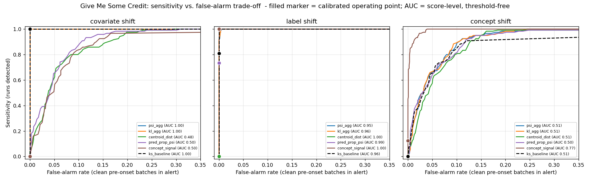

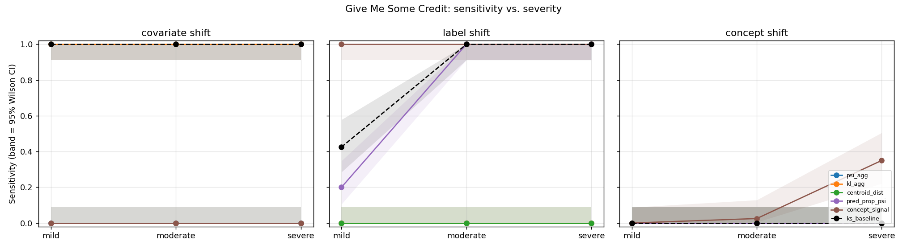

Score AUC = threshold-free separation of pre-onset batches from fully-ramped post-onset batches. Sensitivity @ x% FAR = best sensitivity reachable with at most x% false alarms.

| shift | metric | score AUC | sens. @ 1% FAR | sens. @ 5% FAR |
|---|---|---|---|---|
| covariate | psi_agg | 1.00 | 1.00 | 1.00 |
| covariate | kl_agg | 1.00 | 1.00 | 1.00 |
| covariate | centroid_dist | 0.48 | 0.18 | 0.59 |
| covariate | pred_prop_psi | 0.50 | 0.23 | 0.65 |
| covariate | concept_signal | 0.50 | 0.17 | 0.51 |
| covariate | ks_baseline | 1.00 | 1.00 | 1.00 |
| label | psi_agg | 0.95 | 1.00 | 1.00 |
| label | kl_agg | 0.96 | 1.00 | 1.00 |
| label | centroid_dist | 1.00 | 1.00 | 1.00 |
| label | pred_prop_psi | 0.99 | 1.00 | 1.00 |
| label | concept_signal | 1.00 | 1.00 | 1.00 |
| label | ks_baseline | 0.96 | 1.00 | 1.00 |
| concept | psi_agg | 0.51 | 0.21 | 0.66 |
| concept | kl_agg | 0.51 | 0.22 | 0.67 |
| concept | centroid_dist | 0.51 | 0.12 | 0.57 |
| concept | pred_prop_psi | 0.50 | 0.28 | 0.64 |
| concept | concept_signal | 0.77 | 0.88 | 1.00 |
| concept | ks_baseline | 0.51 | 0.23 | 0.65 |

### The confirmation rule (k consecutive batches), lag and cost

An alert needs k consecutive batches above threshold. k = 2 is used everywhere else; this shows what k buys, for the best detector of each shift type, with the calibrated thresholds. Lag = batches after onset, detected runs only.

| shift | detector | k | sensitivity | false alarms | mean lag (batches) |
|---|---|---|---|---|---|
| covariate | psi_agg | 1 | 1.00 | 0.00% | 0.0 |
| covariate | psi_agg | 2 | 1.00 | 0.00% | 1.0 |
| covariate | psi_agg | 3 | 1.00 | 0.00% | 2.0 |
| covariate | psi_agg | 4 | 1.00 | 0.00% | 3.0 |
| label | concept_signal | 1 | 1.00 | 0.25% | 1.1 |
| label | concept_signal | 2 | 1.00 | 0.00% | 2.5 |
| label | concept_signal | 3 | 0.99 | 0.00% | 3.8 |
| label | concept_signal | 4 | 0.97 | 0.00% | 5.0 |
| concept | concept_signal | 1 | 0.49 | 0.17% | 8.5 |
| concept | concept_signal | 2 | 0.12 | 0.00% | 10.7 |
| concept | concept_signal | 3 | 0.03 | 0.00% | 11.7 |
| concept | concept_signal | 4 | 0.00 | 0.00% | - |

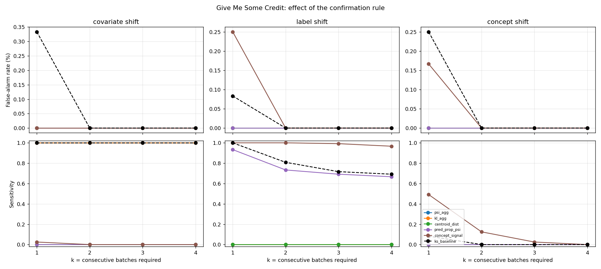

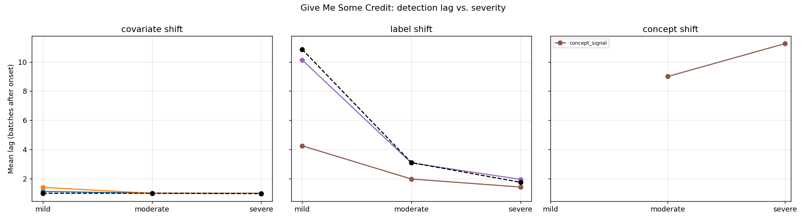

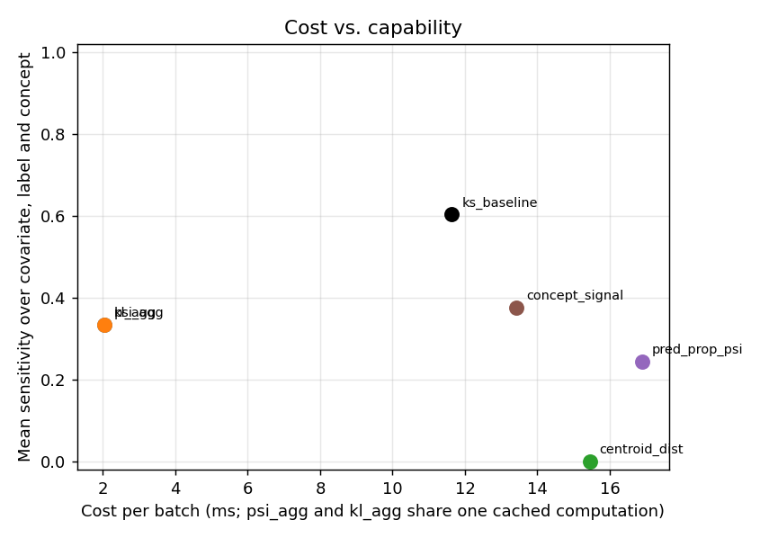

### Against the named baseline

Baseline = per-feature two-sample Kolmogorov-Smirnov test, Bonferroni-corrected, alpha 0.01, same 2-consecutive-batch rule, same runs, no tuning.

| shift | best of the five | its sens. | its false alarms | KS baseline sens. | KS false alarms | gain vs. baseline |
|---|---|---|---|---|---|---|
| concept | concept_signal | 0.12 | 0.00% | 0.00 | 0.00% | 0.12 |
| covariate | psi_agg | 1.00 | 0.00% | 1.00 | 0.00% | 0.00 |
| label | concept_signal | 1.00 | 0.00% | 0.81 | 0.00% | 0.19 |

### What diagnosis.py says when something alerts

Share of post-onset alerting batches by verdict, per true injected shift.

| true_shift_type | concept_or_mild_label | covariate | label | label_or_subtle_covariate |
|---|---|---|---|---|
| concept | 100.0% | 0.0% | 0.0% | 0.0% |
| covariate | 0.0% | 100.0% | 0.0% | 0.0% |
| label | 25.5% | 0.0% | 74.1% | 0.4% |

### Reference model

| reference base rate | reference mean pred. | held-out base rate | held-out mean pred. | held-out accuracy | held-out ROC-AUC |
|---|---|---|---|---|---|
| 0.0702 | 0.0702 | 0.0693 | 0.0698 | 0.9348 | 0.8432 |

### Cost

| detector | per_batch_ms | one_time_fit_ms | throughput_batches_per_sec | approx_memory_kb |
|---|---|---|---|---|
| psi_agg + kl_agg (shared cached bins) | 2.04 | 15.48 | 490.20 | 2.10 |
| centroid_dist | 15.45 | 45.55 | 64.70 | 708.50 |
| pred_prop_psi | 16.89 | 97.43 | 59.20 | 242.00 |
| concept_signal | 13.43 | 28.64 | 74.50 | 4.20 |
| ALL 5 COMBINED (full pipeline per batch) | 47.80 | 171.62 | 20.90 | 956.80 |
| ks_baseline (named baseline, not part of the 5) | 11.64 | 11.45 | 85.90 | 4698.20 |

### Failure modes

78 (shift, severity, onset, detector) cells have sensitivity below 0.5 or mean lag above 5 batches - see `datasets/give_me_some_credit/report_assets/failure_modes.csv`.

### Provenance

`datasets/give_me_some_credit/report_assets/system_info.json`: platform=Windows-10-10.0.26200-SP0, python_version=3.11.0, numpy_version=2.4.4, pandas_version=3.0.2, sklearn_version=1.8.0, scipy_version=1.17.1, matplotlib_version=3.10.0, generated 2026-11-17T04:24:33Z. Run time 661s.

## Taiwan Credit Default

30,000 rows - batch size 750 - reference window 7,500 rows, disjoint from the 22,500-row stream - 18 scenarios x 20 reps = **360 runs**, each with its own fresh split, reference and fitted detectors - thresholds calibrated on 40 separate clean runs. Target feature: `BILL_AMT1`.

### Calibrated thresholds

Each detector's noise floor is measured on clean runs whose seeds are disjoint from every evaluation seed; `moderate = max(default floor, 1.25 x 99th percentile of clean scores)`, `significant = max(floor, 2 x moderate)`. The KS baseline is never tuned.

| detector | default floor | clean median | clean 99th pct | calibrated 'moderate' | calibrated 'significant' | raised above floor? |
|---|---|---|---|---|---|---|
| psi_agg | 0.1 | 0.0230 | 0.0429 | 0.1000 | 0.2500 | no |
| kl_agg | 0.1 | 0.0114 | 0.0211 | 0.1000 | 0.2500 | no |
| centroid_dist | 1 | 0.1144 | 0.2592 | 1.0000 | 2.0000 | no |
| pred_prop_psi | 0.015 | 0.0120 | 0.0303 | 0.0379 | 0.0759 | yes |
| concept_signal | 0.025 | 0.0003 | 0.0437 | 0.0547 | 0.1093 | yes |

### Sensitivity by shift type and severity (mean over onsets)

| shift | severity | psi_agg | kl_agg | centroid_dist | pred_prop_psi | concept_signal | ks_baseline |
|---|---|---|---|---|---|---|---|
| covariate | mild | 1.00 | 1.00 | 0.00 | 0.85 | 0.00 | 1.00 |
| covariate | moderate | 1.00 | 1.00 | 0.00 | 1.00 | 0.00 | 1.00 |
| covariate | severe | 1.00 | 1.00 | 0.00 | 1.00 | 0.00 | 1.00 |
| label | mild | 0.00 | 0.00 | 0.00 | 0.05 | 0.05 | 0.00 |
| label | moderate | 0.00 | 0.00 | 0.00 | 0.47 | 0.62 | 0.25 |
| label | severe | 0.00 | 0.00 | 0.00 | 1.00 | 1.00 | 1.00 |
| concept | mild | 0.00 | 0.00 | 0.00 | 0.00 | 0.00 | 0.00 |
| concept | moderate | 0.00 | 0.00 | 0.00 | 0.00 | 0.10 | 0.00 |
| concept | severe | 0.00 | 0.00 | 0.00 | 0.00 | 0.72 | 0.00 |

### False alarms: batch-level / share of runs with at least one

Batch-level = fraction of the 10 pre-onset (clean) batches in a confirmed alert state. Runs-with-a-false-alarm = fraction of runs in which any pre-onset batch alerted.

| shift | psi_agg | kl_agg | centroid_dist | pred_prop_psi | concept_signal | ks_baseline |
|---|---|---|---|---|---|---|
| covariate | 0.00% / 0.00% | 0.00% / 0.00% | 0.00% / 0.00% | 0.00% / 0.00% | 0.00% / 0.00% | 0.00% / 0.00% |
| label | 0.00% / 0.00% | 0.00% / 0.00% | 0.00% / 0.00% | 0.00% / 0.00% | 0.00% / 0.00% | 0.00% / 0.00% |
| concept | 0.00% / 0.00% | 0.00% / 0.00% | 0.00% / 0.00% | 0.08% / 0.83% | 0.00% / 0.00% | 0.00% / 0.00% |

### Trade-off curves

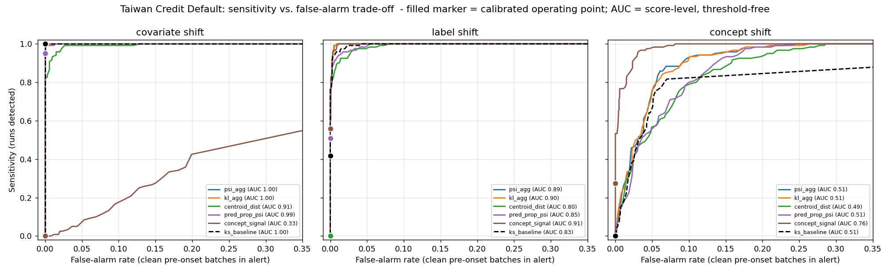

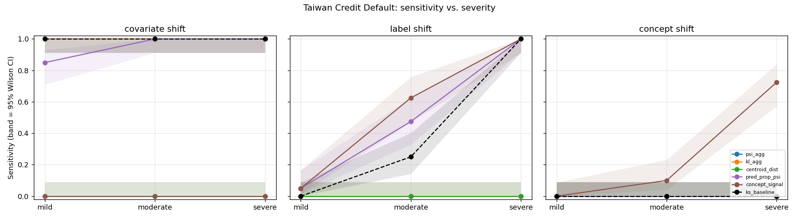

Score AUC = threshold-free separation of pre-onset batches from fully-ramped post-onset batches. Sensitivity @ x% FAR = best sensitivity reachable with at most x% false alarms.

| shift | metric | score AUC | sens. @ 1% FAR | sens. @ 5% FAR |
|---|---|---|---|---|
| covariate | psi_agg | 1.00 | 1.00 | 1.00 |
| covariate | kl_agg | 1.00 | 1.00 | 1.00 |
| covariate | centroid_dist | 0.91 | 0.93 | 0.99 |
| covariate | pred_prop_psi | 0.99 | 0.99 | 1.00 |
| covariate | concept_signal | 0.33 | 0.00 | 0.07 |
| covariate | ks_baseline | 1.00 | 1.00 | 1.00 |
| label | psi_agg | 0.89 | 1.00 | 1.00 |
| label | kl_agg | 0.90 | 1.00 | 1.00 |
| label | centroid_dist | 0.80 | 0.90 | 0.97 |
| label | pred_prop_psi | 0.85 | 0.93 | 0.98 |
| label | concept_signal | 0.91 | 0.99 | 1.00 |
| label | ks_baseline | 0.83 | 0.96 | 1.00 |
| concept | psi_agg | 0.51 | 0.23 | 0.76 |
| concept | kl_agg | 0.51 | 0.24 | 0.71 |
| concept | centroid_dist | 0.49 | 0.17 | 0.57 |
| concept | pred_prop_psi | 0.51 | 0.17 | 0.56 |
| concept | concept_signal | 0.76 | 0.77 | 0.97 |
| concept | ks_baseline | 0.51 | 0.17 | 0.64 |

### The confirmation rule (k consecutive batches), lag and cost

An alert needs k consecutive batches above threshold. k = 2 is used everywhere else; this shows what k buys, for the best detector of each shift type, with the calibrated thresholds. Lag = batches after onset, detected runs only.

| shift | detector | k | sensitivity | false alarms | mean lag (batches) |
|---|---|---|---|---|---|
| covariate | psi_agg | 1 | 1.00 | 0.00% | 0.0 |
| covariate | psi_agg | 2 | 1.00 | 0.00% | 1.0 |
| covariate | psi_agg | 3 | 1.00 | 0.00% | 2.0 |
| covariate | psi_agg | 4 | 1.00 | 0.00% | 3.0 |
| label | concept_signal | 1 | 0.91 | 0.42% | 4.4 |
| label | concept_signal | 2 | 0.56 | 0.00% | 4.9 |
| label | concept_signal | 3 | 0.42 | 0.00% | 5.2 |
| label | concept_signal | 4 | 0.36 | 0.00% | 5.9 |
| concept | concept_signal | 1 | 0.67 | 0.17% | 6.2 |
| concept | concept_signal | 2 | 0.28 | 0.00% | 10.0 |
| concept | concept_signal | 3 | 0.08 | 0.00% | 12.8 |
| concept | concept_signal | 4 | 0.02 | 0.00% | 16.5 |

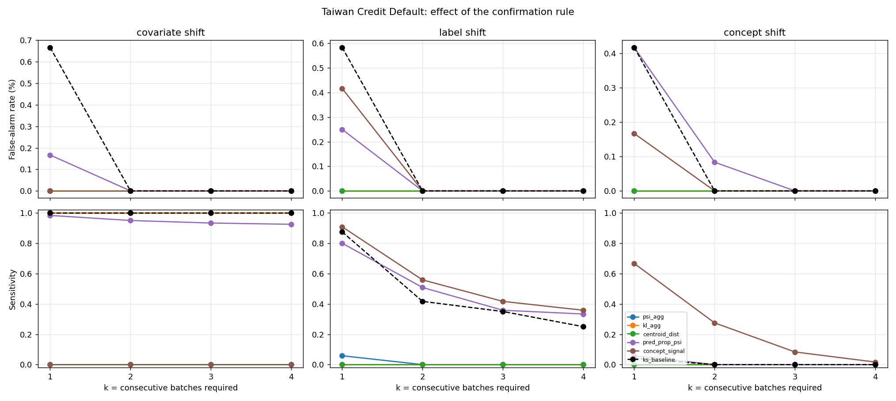

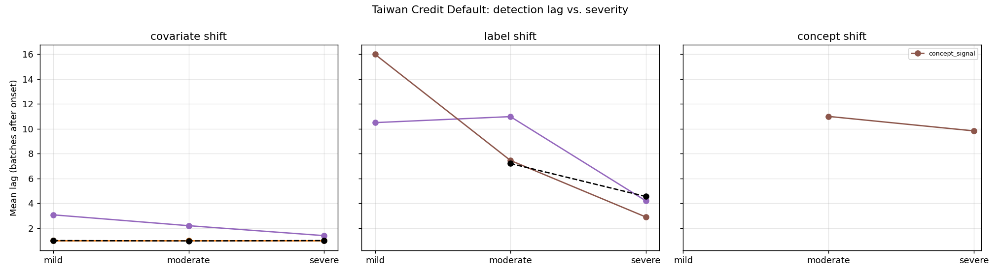

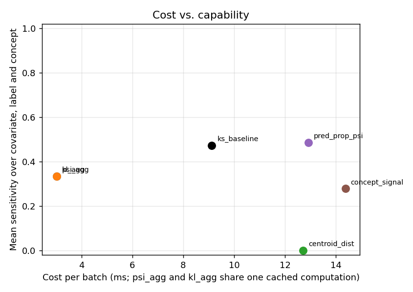

### Against the named baseline

Baseline = per-feature two-sample Kolmogorov-Smirnov test, Bonferroni-corrected, alpha 0.01, same 2-consecutive-batch rule, same runs, no tuning.

| shift | best of the five | its sens. | its false alarms | KS baseline sens. | KS false alarms | gain vs. baseline |
|---|---|---|---|---|---|---|
| concept | concept_signal | 0.28 | 0.00% | 0.00 | 0.00% | 0.28 |
| covariate | psi_agg | 1.00 | 0.00% | 1.00 | 0.00% | 0.00 |
| label | concept_signal | 0.56 | 0.00% | 0.42 | 0.00% | 0.14 |

### What diagnosis.py says when something alerts

Share of post-onset alerting batches by verdict, per true injected shift.

| true_shift_type | concept_or_mild_label | covariate | label | label_or_subtle_covariate |
|---|---|---|---|---|
| concept | 100.0% | 0.0% | 0.0% | 0.0% |
| covariate | 0.0% | 100.0% | 0.0% | 0.0% |
| label | 39.1% | 0.0% | 47.0% | 13.9% |

### Reference model

| reference base rate | reference mean pred. | held-out base rate | held-out mean pred. | held-out accuracy | held-out ROC-AUC |
|---|---|---|---|---|---|
| 0.2176 | 0.2176 | 0.2224 | 0.2195 | 0.8113 | 0.7200 |

### Cost

| detector | per_batch_ms | one_time_fit_ms | throughput_batches_per_sec | approx_memory_kb |
|---|---|---|---|---|
| psi_agg + kl_agg (shared cached bins) | 3.02 | 14.73 | 330.80 | 4.40 |
| centroid_dist | 12.72 | 34.96 | 78.60 | 180.70 |
| pred_prop_psi | 12.91 | 68.55 | 77.40 | 67.10 |
| concept_signal | 14.38 | 17.63 | 69.50 | 4.90 |
| ALL 5 COMBINED (full pipeline per batch) | 43.04 | 121.14 | 23.20 | 257.10 |
| ks_baseline (named baseline, not part of the 5) | 9.13 | 7.14 | 109.60 | 2345.70 |

### Failure modes

80 (shift, severity, onset, detector) cells have sensitivity below 0.5 or mean lag above 5 batches - see `datasets/taiwan_credit_default/report_assets_taiwan/failure_modes.csv`.

### Provenance

`datasets/taiwan_credit_default/report_assets_taiwan/system_info.json`: platform=Windows-10-10.0.26200-SP0, python_version=3.11.0, numpy_version=2.4.4, pandas_version=3.0.2, sklearn_version=1.8.0, scipy_version=1.17.1, matplotlib_version=3.10.0, generated 2026-11-17T04:34:23Z. Run time 590s.

## Adult Income

48,842 rows - batch size 1,221 - reference window 12,210 rows, disjoint from the 36,630-row stream - 18 scenarios x 20 reps = **360 runs**, each with its own fresh split, reference and fitted detectors - thresholds calibrated on 40 separate clean runs. Target feature: `hours-per-week`.

### Calibrated thresholds

Each detector's noise floor is measured on clean runs whose seeds are disjoint from every evaluation seed; `moderate = max(default floor, 1.25 x 99th percentile of clean scores)`, `significant = max(floor, 2 x moderate)`. The KS baseline is never tuned.

| detector | default floor | clean median | clean 99th pct | calibrated 'moderate' | calibrated 'significant' | raised above floor? |
|---|---|---|---|---|---|---|
| psi_agg | 0.1 | 0.0103 | 0.0201 | 0.1000 | 0.2500 | no |
| kl_agg | 0.1 | 0.0051 | 0.0100 | 0.1000 | 0.2500 | no |
| centroid_dist | 1 | 0.0493 | 0.1086 | 1.0000 | 2.0000 | no |
| pred_prop_psi | 0.015 | 0.0075 | 0.0189 | 0.0237 | 0.0473 | yes |
| concept_signal | 0.025 | 0.0000 | 0.0356 | 0.0446 | 0.0891 | yes |

### Sensitivity by shift type and severity (mean over onsets)

| shift | severity | psi_agg | kl_agg | centroid_dist | pred_prop_psi | concept_signal | ks_baseline |
|---|---|---|---|---|---|---|---|
| covariate | mild | 0.03 | 0.03 | 0.00 | 0.03 | 0.00 | 1.00 |
| covariate | moderate | 0.10 | 0.10 | 0.00 | 0.77 | 0.00 | 1.00 |
| covariate | severe | 1.00 | 0.05 | 0.00 | 1.00 | 0.00 | 1.00 |
| label | mild | 0.00 | 0.00 | 0.00 | 0.20 | 0.00 | 0.10 |
| label | moderate | 0.00 | 0.00 | 0.00 | 0.95 | 0.45 | 0.72 |
| label | severe | 0.00 | 0.00 | 0.00 | 1.00 | 1.00 | 1.00 |
| concept | mild | 0.00 | 0.00 | 0.00 | 0.00 | 0.90 | 0.00 |
| concept | moderate | 0.00 | 0.00 | 0.00 | 0.00 | 1.00 | 0.00 |
| concept | severe | 0.00 | 0.00 | 0.00 | 0.00 | 1.00 | 0.00 |

### False alarms: batch-level / share of runs with at least one

Batch-level = fraction of the 10 pre-onset (clean) batches in a confirmed alert state. Runs-with-a-false-alarm = fraction of runs in which any pre-onset batch alerted.

| shift | psi_agg | kl_agg | centroid_dist | pred_prop_psi | concept_signal | ks_baseline |
|---|---|---|---|---|---|---|
| covariate | 0.00% / 0.00% | 0.00% / 0.00% | 0.00% / 0.00% | 0.00% / 0.00% | 0.00% / 0.00% | 0.00% / 0.00% |
| label | 0.00% / 0.00% | 0.00% / 0.00% | 0.00% / 0.00% | 0.00% / 0.00% | 0.00% / 0.00% | 0.00% / 0.00% |
| concept | 0.00% / 0.00% | 0.00% / 0.00% | 0.00% / 0.00% | 0.00% / 0.00% | 0.00% / 0.00% | 0.00% / 0.00% |

### Trade-off curves

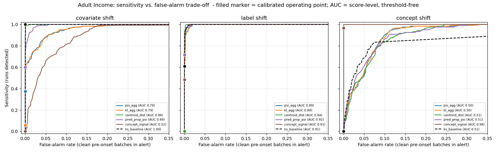

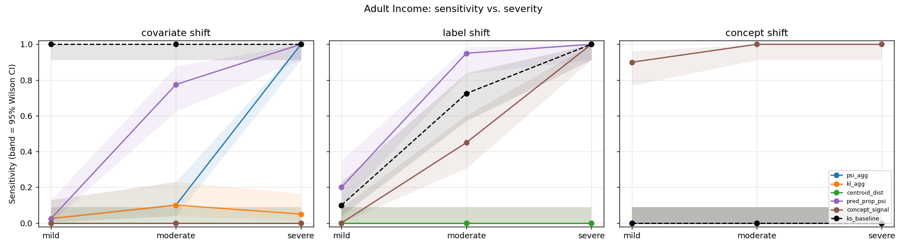

Score AUC = threshold-free separation of pre-onset batches from fully-ramped post-onset batches. Sensitivity @ x% FAR = best sensitivity reachable with at most x% false alarms.

| shift | metric | score AUC | sens. @ 1% FAR | sens. @ 5% FAR |
|---|---|---|---|---|
| covariate | psi_agg | 0.79 | 0.67 | 0.88 |
| covariate | kl_agg | 0.79 | 0.67 | 0.88 |
| covariate | centroid_dist | 0.96 | 0.99 | 1.00 |
| covariate | pred_prop_psi | 0.89 | 0.93 | 0.99 |
| covariate | concept_signal | 0.52 | 0.23 | 0.66 |
| covariate | ks_baseline | 1.00 | 1.00 | 1.00 |
| label | psi_agg | 0.89 | 0.96 | 1.00 |
| label | kl_agg | 0.89 | 0.96 | 1.00 |
| label | centroid_dist | 0.94 | 1.00 | 1.00 |
| label | pred_prop_psi | 0.92 | 0.98 | 1.00 |
| label | concept_signal | 0.91 | 1.00 | 1.00 |
| label | ks_baseline | 0.91 | 0.99 | 1.00 |
| concept | psi_agg | 0.50 | 0.21 | 0.51 |
| concept | kl_agg | 0.50 | 0.24 | 0.51 |
| concept | centroid_dist | 0.51 | 0.16 | 0.56 |
| concept | pred_prop_psi | 0.51 | 0.26 | 0.59 |
| concept | concept_signal | 0.98 | 1.00 | 1.00 |
| concept | ks_baseline | 0.51 | 0.29 | 0.68 |

### The confirmation rule (k consecutive batches), lag and cost

An alert needs k consecutive batches above threshold. k = 2 is used everywhere else; this shows what k buys, for the best detector of each shift type, with the calibrated thresholds. Lag = batches after onset, detected runs only.

| shift | detector | k | sensitivity | false alarms | mean lag (batches) |
|---|---|---|---|---|---|
| covariate | pred_prop_psi | 1 | 0.84 | 0.08% | 4.5 |
| covariate | pred_prop_psi | 2 | 0.60 | 0.00% | 4.8 |
| covariate | pred_prop_psi | 3 | 0.49 | 0.00% | 5.9 |
| covariate | pred_prop_psi | 4 | 0.41 | 0.00% | 5.7 |
| label | pred_prop_psi | 1 | 0.89 | 0.08% | 3.5 |
| label | pred_prop_psi | 2 | 0.72 | 0.00% | 4.9 |
| label | pred_prop_psi | 3 | 0.55 | 0.00% | 5.5 |
| label | pred_prop_psi | 4 | 0.50 | 0.00% | 6.2 |
| concept | concept_signal | 1 | 1.00 | 0.17% | 1.9 |
| concept | concept_signal | 2 | 0.97 | 0.00% | 3.8 |
| concept | concept_signal | 3 | 0.82 | 0.00% | 4.4 |
| concept | concept_signal | 4 | 0.73 | 0.00% | 4.7 |

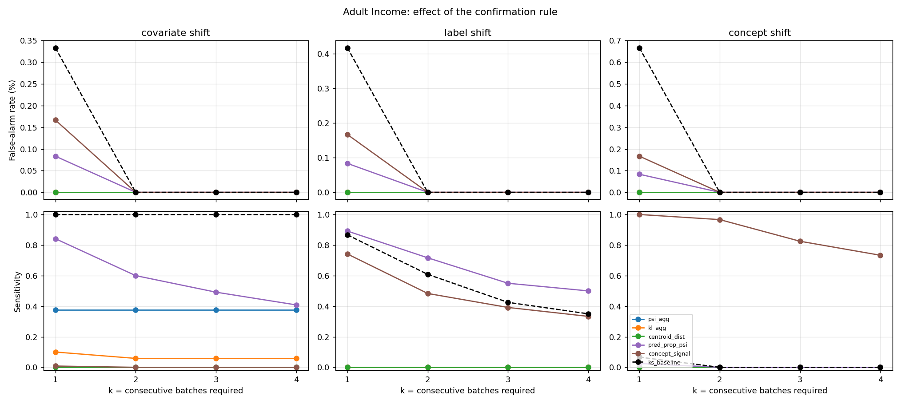

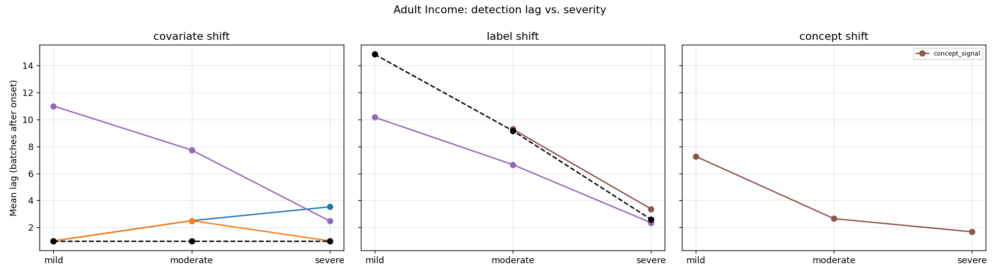

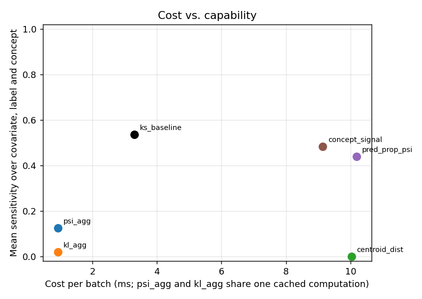

### Against the named baseline

Baseline = per-feature two-sample Kolmogorov-Smirnov test, Bonferroni-corrected, alpha 0.01, same 2-consecutive-batch rule, same runs, no tuning.

| shift | best of the five | its sens. | its false alarms | KS baseline sens. | KS false alarms | gain vs. baseline |
|---|---|---|---|---|---|---|
| concept | concept_signal | 0.97 | 0.00% | 0.00 | 0.00% | 0.97 |
| covariate | pred_prop_psi | 0.60 | 0.00% | 1.00 | 0.00% | -0.40 |
| label | pred_prop_psi | 0.72 | 0.00% | 0.61 | 0.00% | 0.11 |

### What diagnosis.py says when something alerts

Share of post-onset alerting batches by verdict, per true injected shift.

| true_shift_type | concept_or_mild_label | covariate | label | label_or_subtle_covariate |
|---|---|---|---|---|
| concept | 100.0% | 0.0% | 0.0% | 0.0% |
| covariate | 0.0% | 75.6% | 0.0% | 24.4% |
| label | 3.3% | 0.0% | 56.3% | 40.3% |

### Reference model

| reference base rate | reference mean pred. | held-out base rate | held-out mean pred. | held-out accuracy | held-out ROC-AUC |
|---|---|---|---|---|---|
| 0.2405 | 0.2405 | 0.2388 | 0.2388 | 0.8158 | 0.8308 |

### Cost

| detector | per_batch_ms | one_time_fit_ms | throughput_batches_per_sec | approx_memory_kb |
|---|---|---|---|---|
| psi_agg + kl_agg (shared cached bins) | 0.93 | 4.99 | 1071.30 | 1.30 |
| centroid_dist | 10.03 | 18.68 | 99.70 | 289.40 |
| pred_prop_psi | 10.18 | 38.22 | 98.20 | 101.30 |
| concept_signal | 9.14 | 11.89 | 109.50 | 3.50 |
| ALL 5 COMBINED (full pipeline per batch) | 30.27 | 68.78 | 33.00 | 395.50 |
| ks_baseline (named baseline, not part of the 5) | 3.30 | 2.93 | 303.10 | 1145.50 |

### Failure modes

90 (shift, severity, onset, detector) cells have sensitivity below 0.5 or mean lag above 5 batches - see `datasets/adult_income/report_assets_adult/failure_modes.csv`.

### Provenance

`datasets/adult_income/report_assets_adult/system_info.json`: platform=Windows-10-10.0.26200-SP0, python_version=3.11.0, numpy_version=2.4.4, pandas_version=3.0.2, sklearn_version=1.8.0, scipy_version=1.17.1, matplotlib_version=3.10.0, generated 2026-11-17T04:40:41Z. Run time 378s.

## 6. Hand-labelled check

Four streams plus a mild-label stream were built by hand from an explicit recipe (not with the injectors) with hand-written per-batch truth. Batches 10-11 are excluded
(2-consecutive-batch confirmation lag). `alert_correct` = the suite alerted exactly when the hand label says something is wrong; `diagnosis_in_accepted_set` = `diagnosis.py`'s verdict was in the set of verdicts declared before running.
Per-batch rows: `validation/hand_labelled_check.csv`; recipe and accepted verdicts: `validation/hand_labelled_check.py`.

| stream | batches_scored | alert_correct | diagnosis_in_accepted_set |
|---|---|---|---|
| clean | 18 | 100.0% | 100.0% |
| concept | 18 | 100.0% | 100.0% |
| covariate | 18 | 100.0% | 100.0% |
| label | 18 | 88.9% | 55.6% |
| label_mild | 18 | 55.6% | 55.6% |

These labels are hand-written from how each stream was constructed. They are independent of the injectors, not of the authors, and are not annotations of real incidents (none of the three public datasets has a timestamped, confirmed drift event).

## 7. Limitations

- Conventional floors for PSI, KL and `centroid_dist` are conservative; the trade-off curves show these detectors reach higher sensitivity at low false-alarm rates than their operating points report. Calibration only ever raises thresholds above the floor.
- Calibration and evaluation draw from the same finite pool of rows through different random splits, so the false-alarm rates are out-of-sample with respect to the calibration runs, not with respect to the population.
- Pure concept drift (P(X) and P(Y) unchanged) is hard to detect; only the Brier-based `concept_signal` responds (how well varies a lot by dataset, see the tables), and it needs labels (a 20 % same-batch trickle here; real feedback is delayed).
- Label shift is implemented by resampling, which moves P(X) whenever features carry information about the label; X-only detectors can therefore catch it. This is a property of label shift, not a defect.
- Binary labels and numeric features only; three datasets; 20 repetitions per cell (CIs are wide near 0 and 1).
- Each rep is an independent random split of the same pool of rows, so reps are not independent samples of a population.
