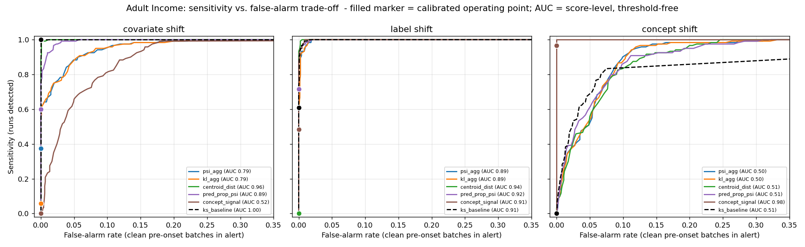
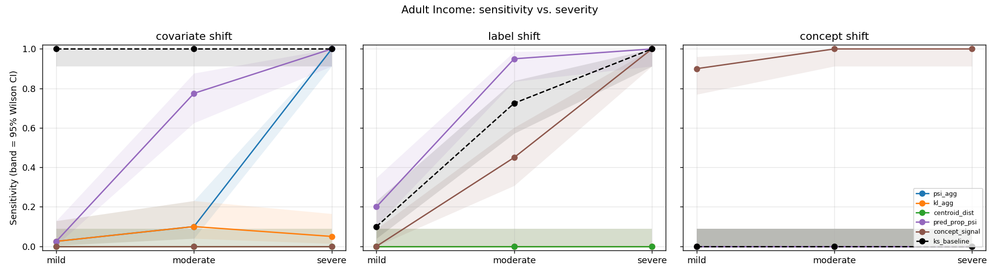
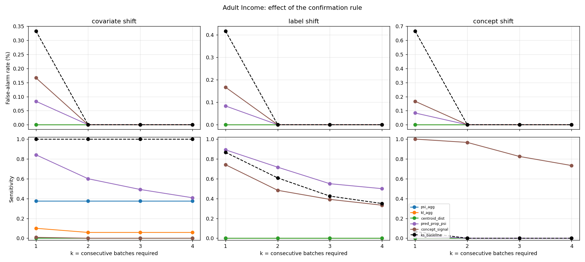
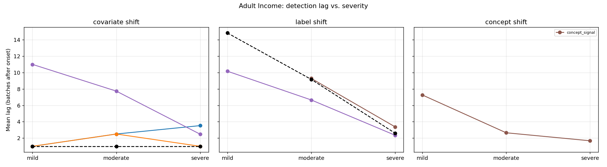
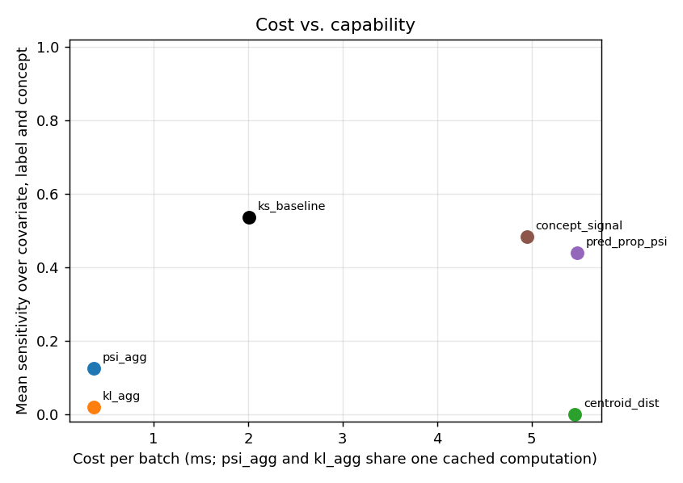

# Adult Income - generated results

_Generated by `tools/build_docs.py` from `datasets/adult_income/report_assets_adult/`. Do not edit by hand._

48,842 rows - batch size 1,221 - reference window 12,210 rows, disjoint from the 36,630-row stream - 18 scenarios x 20 reps = **360 runs**, each with its own fresh split, reference and fitted detectors - thresholds calibrated on 40 separate clean runs. Target feature: `hours-per-week`.

### Calibrated thresholds

Each detector's noise floor is measured on clean runs whose seeds are disjoint from every evaluation seed; `moderate = max(default floor, 1.25 x 99th percentile of clean scores)`, `significant = max(floor, 2 x moderate)`. The KS baseline is never tuned.

| detector | default floor | clean median | clean 99th pct | calibrated 'moderate' | calibrated 'significant' | raised above floor? |
|---|---|---|---|---|---|---|
| psi_agg | 0.1 | 0.0103 | 0.0201 | 0.1000 | 0.2500 | no |
| kl_agg | 0.1 | 0.0051 | 0.0100 | 0.1000 | 0.2500 | no |
| centroid_dist | 1 | 0.0493 | 0.1086 | 1.0000 | 2.0000 | no |
| pred_prop_psi | 0.015 | 0.0075 | 0.0189 | 0.0237 | 0.0473 | yes |
| concept_signal | 0.025 | 0.0000 | 0.0356 | 0.0446 | 0.0891 | yes |

### Sensitivity by shift type and severity (mean over onsets)

| shift | severity | psi_agg | kl_agg | centroid_dist | pred_prop_psi | concept_signal | ks_baseline |
|---|---|---|---|---|---|---|---|
| covariate | mild | 0.03 | 0.03 | 0.00 | 0.03 | 0.00 | 1.00 |
| covariate | moderate | 0.10 | 0.10 | 0.00 | 0.77 | 0.00 | 1.00 |
| covariate | severe | 1.00 | 0.05 | 0.00 | 1.00 | 0.00 | 1.00 |
| label | mild | 0.00 | 0.00 | 0.00 | 0.20 | 0.00 | 0.10 |
| label | moderate | 0.00 | 0.00 | 0.00 | 0.95 | 0.45 | 0.72 |
| label | severe | 0.00 | 0.00 | 0.00 | 1.00 | 1.00 | 1.00 |
| concept | mild | 0.00 | 0.00 | 0.00 | 0.00 | 0.90 | 0.00 |
| concept | moderate | 0.00 | 0.00 | 0.00 | 0.00 | 1.00 | 0.00 |
| concept | severe | 0.00 | 0.00 | 0.00 | 0.00 | 1.00 | 0.00 |

### False alarms: batch-level / share of runs with at least one

Batch-level = fraction of the 10 pre-onset (clean) batches in a confirmed alert state. Runs-with-a-false-alarm = fraction of runs in which any pre-onset batch alerted.

| shift | psi_agg | kl_agg | centroid_dist | pred_prop_psi | concept_signal | ks_baseline |
|---|---|---|---|---|---|---|
| covariate | 0.00% / 0.00% | 0.00% / 0.00% | 0.00% / 0.00% | 0.00% / 0.00% | 0.00% / 0.00% | 0.00% / 0.00% |
| label | 0.00% / 0.00% | 0.00% / 0.00% | 0.00% / 0.00% | 0.00% / 0.00% | 0.00% / 0.00% | 0.00% / 0.00% |
| concept | 0.00% / 0.00% | 0.00% / 0.00% | 0.00% / 0.00% | 0.00% / 0.00% | 0.00% / 0.00% | 0.00% / 0.00% |

### Trade-off curves

Score AUC = threshold-free separation of pre-onset batches from fully-ramped post-onset batches. Sensitivity @ x% FAR = best sensitivity reachable with at most x% false alarms.

| shift | metric | score AUC | sens. @ 1% FAR | sens. @ 5% FAR |
|---|---|---|---|---|
| covariate | psi_agg | 0.79 | 0.67 | 0.88 |
| covariate | kl_agg | 0.79 | 0.67 | 0.88 |
| covariate | centroid_dist | 0.96 | 0.99 | 1.00 |
| covariate | pred_prop_psi | 0.89 | 0.93 | 0.99 |
| covariate | concept_signal | 0.52 | 0.23 | 0.66 |
| covariate | ks_baseline | 1.00 | 1.00 | 1.00 |
| label | psi_agg | 0.89 | 0.96 | 1.00 |
| label | kl_agg | 0.89 | 0.96 | 1.00 |
| label | centroid_dist | 0.94 | 1.00 | 1.00 |
| label | pred_prop_psi | 0.92 | 0.98 | 1.00 |
| label | concept_signal | 0.91 | 1.00 | 1.00 |
| label | ks_baseline | 0.91 | 0.99 | 1.00 |
| concept | psi_agg | 0.50 | 0.21 | 0.51 |
| concept | kl_agg | 0.50 | 0.24 | 0.51 |
| concept | centroid_dist | 0.51 | 0.16 | 0.56 |
| concept | pred_prop_psi | 0.51 | 0.26 | 0.59 |
| concept | concept_signal | 0.98 | 1.00 | 1.00 |
| concept | ks_baseline | 0.51 | 0.29 | 0.68 |

### The confirmation rule (k consecutive batches), lag and cost

An alert needs k consecutive batches above threshold. k = 2 is used everywhere else; this shows what k buys, for the best detector of each shift type, with the calibrated thresholds. Lag = batches after onset, detected runs only.

| shift | detector | k | sensitivity | false alarms | mean lag (batches) |
|---|---|---|---|---|---|
| covariate | pred_prop_psi | 1 | 0.84 | 0.08% | 4.5 |
| covariate | pred_prop_psi | 2 | 0.60 | 0.00% | 4.8 |
| covariate | pred_prop_psi | 3 | 0.49 | 0.00% | 5.9 |
| covariate | pred_prop_psi | 4 | 0.41 | 0.00% | 5.7 |
| label | pred_prop_psi | 1 | 0.89 | 0.08% | 3.5 |
| label | pred_prop_psi | 2 | 0.72 | 0.00% | 4.9 |
| label | pred_prop_psi | 3 | 0.55 | 0.00% | 5.5 |
| label | pred_prop_psi | 4 | 0.50 | 0.00% | 6.2 |
| concept | concept_signal | 1 | 1.00 | 0.17% | 1.9 |
| concept | concept_signal | 2 | 0.97 | 0.00% | 3.8 |
| concept | concept_signal | 3 | 0.82 | 0.00% | 4.4 |
| concept | concept_signal | 4 | 0.73 | 0.00% | 4.7 |

### Against the named baseline

Baseline = per-feature two-sample Kolmogorov-Smirnov test, Bonferroni-corrected, alpha 0.01, same 2-consecutive-batch rule, same runs, no tuning.

| shift | best of the five | its sens. | its false alarms | KS baseline sens. | KS false alarms | gain vs. baseline |
|---|---|---|---|---|---|---|
| concept | concept_signal | 0.97 | 0.00% | 0.00 | 0.00% | 0.97 |
| covariate | pred_prop_psi | 0.60 | 0.00% | 1.00 | 0.00% | -0.40 |
| label | pred_prop_psi | 0.72 | 0.00% | 0.61 | 0.00% | 0.11 |

### What diagnosis.py says when something alerts

Share of post-onset alerting batches by verdict, per true injected shift.

| true_shift_type | concept_or_mild_label | covariate | label | label_or_subtle_covariate |
|---|---|---|---|---|
| concept | 100.0% | 0.0% | 0.0% | 0.0% |
| covariate | 0.0% | 75.6% | 0.0% | 24.4% |
| label | 3.3% | 0.0% | 56.3% | 40.3% |

### Reference model

| reference base rate | reference mean pred. | held-out base rate | held-out mean pred. | held-out accuracy | held-out ROC-AUC |
|---|---|---|---|---|---|
| 0.2405 | 0.2405 | 0.2388 | 0.2388 | 0.8158 | 0.8308 |

### Cost

| detector | per_batch_ms | one_time_fit_ms | throughput_batches_per_sec | approx_memory_kb |
|---|---|---|---|---|
| psi_agg + kl_agg (shared cached bins) | 0.37 | 3.12 | 2722.00 | 1.30 |
| centroid_dist | 5.46 | 11.29 | 183.20 | 289.40 |
| pred_prop_psi | 5.48 | 22.43 | 182.50 | 101.30 |
| concept_signal | 4.95 | 6.94 | 202.00 | 3.50 |
| ALL 5 COMBINED (full pipeline per batch) | 16.25 | 40.66 | 61.50 | 395.50 |
| ks_baseline (named baseline, not part of the 5) | 2.01 | 1.97 | 498.40 | 1145.50 |

### Failure modes

90 (shift, severity, onset, detector) cells have sensitivity below 0.5 or mean lag above 5 batches - see `datasets/adult_income/report_assets_adult/failure_modes.csv`.

### Provenance

`datasets/adult_income/report_assets_adult/system_info.json`: platform=Linux-6.18.44-fc-v553-x86_64-with-glibc2.39, python_version=3.12.3, numpy_version=2.4.4, pandas_version=3.0.2, sklearn_version=1.8.0, scipy_version=1.17.1, matplotlib_version=3.10.0, generated 2026-11-17T03:54:09Z. Run time 210s.
