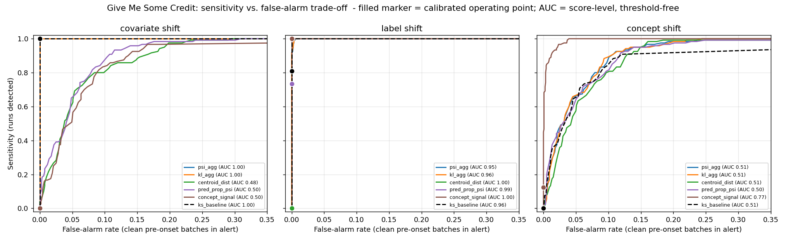
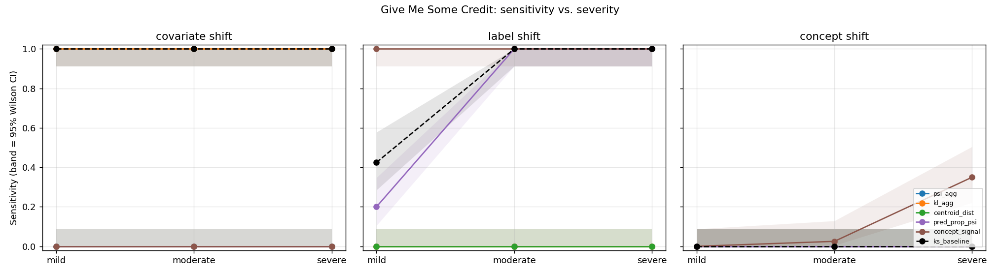
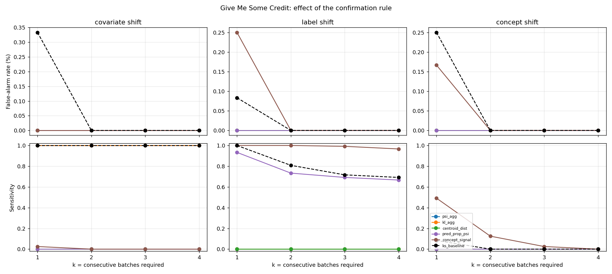
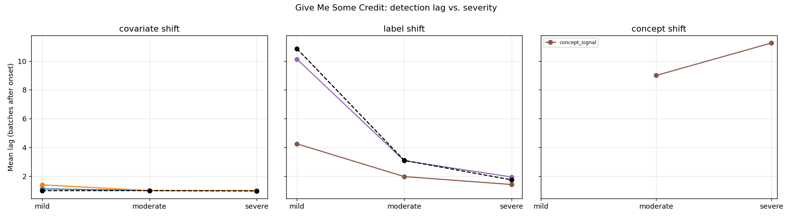
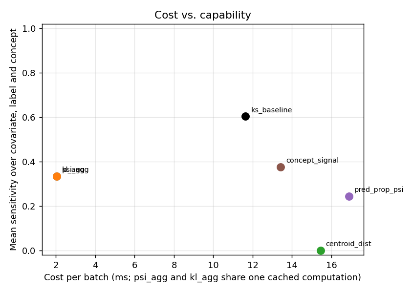

# Give Me Some Credit - generated results

_Generated by `tools/build_docs.py` from `datasets/give_me_some_credit/report_assets/`. Do not edit by hand._

120,269 rows - batch size 3,006 - reference window 30,060 rows, disjoint from the 90,180-row stream - 18 scenarios x 20 reps = **360 runs**, each with its own fresh split, reference and fitted detectors - thresholds calibrated on 40 separate clean runs. Target feature: `DebtRatio`.

### Calibrated thresholds

Each detector's noise floor is measured on clean runs whose seeds are disjoint from every evaluation seed; `moderate = max(default floor, 1.25 x 99th percentile of clean scores)`, `significant = max(floor, 2 x moderate)`. The KS baseline is never tuned.

| detector | default floor | clean median | clean 99th pct | calibrated 'moderate' | calibrated 'significant' | raised above floor? |
|---|---|---|---|---|---|---|
| psi_agg | 0.1 | 0.0050 | 0.0092 | 0.1000 | 0.2500 | no |
| kl_agg | 0.1 | 0.0025 | 0.0046 | 0.1000 | 0.2500 | no |
| centroid_dist | 1 | 0.0375 | 0.0832 | 1.0000 | 2.0000 | no |
| pred_prop_psi | 0.015 | 0.0031 | 0.0080 | 0.0150 | 0.0300 | no |
| concept_signal | 0.025 | 0.0000 | 0.0164 | 0.0250 | 0.0500 | no |

### Sensitivity by shift type and severity (mean over onsets)

| shift | severity | psi_agg | kl_agg | centroid_dist | pred_prop_psi | concept_signal | ks_baseline |
|---|---|---|---|---|---|---|---|
| covariate | mild | 1.00 | 1.00 | 0.00 | 0.00 | 0.00 | 1.00 |
| covariate | moderate | 1.00 | 1.00 | 0.00 | 0.00 | 0.00 | 1.00 |
| covariate | severe | 1.00 | 1.00 | 0.00 | 0.00 | 0.00 | 1.00 |
| label | mild | 0.00 | 0.00 | 0.00 | 0.20 | 1.00 | 0.42 |
| label | moderate | 0.00 | 0.00 | 0.00 | 1.00 | 1.00 | 1.00 |
| label | severe | 0.00 | 0.00 | 0.00 | 1.00 | 1.00 | 1.00 |
| concept | mild | 0.00 | 0.00 | 0.00 | 0.00 | 0.00 | 0.00 |
| concept | moderate | 0.00 | 0.00 | 0.00 | 0.00 | 0.03 | 0.00 |
| concept | severe | 0.00 | 0.00 | 0.00 | 0.00 | 0.35 | 0.00 |

### False alarms: batch-level / share of runs with at least one

Batch-level = fraction of the 10 pre-onset (clean) batches in a confirmed alert state. Runs-with-a-false-alarm = fraction of runs in which any pre-onset batch alerted.

| shift | psi_agg | kl_agg | centroid_dist | pred_prop_psi | concept_signal | ks_baseline |
|---|---|---|---|---|---|---|
| covariate | 0.00% / 0.00% | 0.00% / 0.00% | 0.00% / 0.00% | 0.00% / 0.00% | 0.00% / 0.00% | 0.00% / 0.00% |
| label | 0.00% / 0.00% | 0.00% / 0.00% | 0.00% / 0.00% | 0.00% / 0.00% | 0.00% / 0.00% | 0.00% / 0.00% |
| concept | 0.00% / 0.00% | 0.00% / 0.00% | 0.00% / 0.00% | 0.00% / 0.00% | 0.00% / 0.00% | 0.00% / 0.00% |

### Trade-off curves

Score AUC = threshold-free separation of pre-onset batches from fully-ramped post-onset batches. Sensitivity @ x% FAR = best sensitivity reachable with at most x% false alarms.

| shift | metric | score AUC | sens. @ 1% FAR | sens. @ 5% FAR |
|---|---|---|---|---|
| covariate | psi_agg | 1.00 | 1.00 | 1.00 |
| covariate | kl_agg | 1.00 | 1.00 | 1.00 |
| covariate | centroid_dist | 0.48 | 0.18 | 0.59 |
| covariate | pred_prop_psi | 0.50 | 0.23 | 0.65 |
| covariate | concept_signal | 0.50 | 0.17 | 0.51 |
| covariate | ks_baseline | 1.00 | 1.00 | 1.00 |
| label | psi_agg | 0.95 | 1.00 | 1.00 |
| label | kl_agg | 0.96 | 1.00 | 1.00 |
| label | centroid_dist | 1.00 | 1.00 | 1.00 |
| label | pred_prop_psi | 0.99 | 1.00 | 1.00 |
| label | concept_signal | 1.00 | 1.00 | 1.00 |
| label | ks_baseline | 0.96 | 1.00 | 1.00 |
| concept | psi_agg | 0.51 | 0.21 | 0.66 |
| concept | kl_agg | 0.51 | 0.22 | 0.67 |
| concept | centroid_dist | 0.51 | 0.12 | 0.57 |
| concept | pred_prop_psi | 0.50 | 0.28 | 0.64 |
| concept | concept_signal | 0.77 | 0.88 | 1.00 |
| concept | ks_baseline | 0.51 | 0.23 | 0.65 |

### The confirmation rule (k consecutive batches), lag and cost

An alert needs k consecutive batches above threshold. k = 2 is used everywhere else; this shows what k buys, for the best detector of each shift type, with the calibrated thresholds. Lag = batches after onset, detected runs only.

| shift | detector | k | sensitivity | false alarms | mean lag (batches) |
|---|---|---|---|---|---|
| covariate | psi_agg | 1 | 1.00 | 0.00% | 0.0 |
| covariate | psi_agg | 2 | 1.00 | 0.00% | 1.0 |
| covariate | psi_agg | 3 | 1.00 | 0.00% | 2.0 |
| covariate | psi_agg | 4 | 1.00 | 0.00% | 3.0 |
| label | concept_signal | 1 | 1.00 | 0.25% | 1.1 |
| label | concept_signal | 2 | 1.00 | 0.00% | 2.5 |
| label | concept_signal | 3 | 0.99 | 0.00% | 3.8 |
| label | concept_signal | 4 | 0.97 | 0.00% | 5.0 |
| concept | concept_signal | 1 | 0.49 | 0.17% | 8.5 |
| concept | concept_signal | 2 | 0.12 | 0.00% | 10.7 |
| concept | concept_signal | 3 | 0.03 | 0.00% | 11.7 |
| concept | concept_signal | 4 | 0.00 | 0.00% | - |

### Against the named baseline

Baseline = per-feature two-sample Kolmogorov-Smirnov test, Bonferroni-corrected, alpha 0.01, same 2-consecutive-batch rule, same runs, no tuning.

| shift | best of the five | its sens. | its false alarms | KS baseline sens. | KS false alarms | gain vs. baseline |
|---|---|---|---|---|---|---|
| concept | concept_signal | 0.12 | 0.00% | 0.00 | 0.00% | 0.12 |
| covariate | psi_agg | 1.00 | 0.00% | 1.00 | 0.00% | 0.00 |
| label | concept_signal | 1.00 | 0.00% | 0.81 | 0.00% | 0.19 |

### What diagnosis.py says when something alerts

Share of post-onset alerting batches by verdict, per true injected shift.

| true_shift_type | concept_or_mild_label | covariate | label | label_or_subtle_covariate |
|---|---|---|---|---|
| concept | 100.0% | 0.0% | 0.0% | 0.0% |
| covariate | 0.0% | 100.0% | 0.0% | 0.0% |
| label | 25.5% | 0.0% | 74.1% | 0.4% |

### Reference model

| reference base rate | reference mean pred. | held-out base rate | held-out mean pred. | held-out accuracy | held-out ROC-AUC |
|---|---|---|---|---|---|
| 0.0702 | 0.0702 | 0.0693 | 0.0698 | 0.9348 | 0.8432 |

### Cost

| detector | per_batch_ms | one_time_fit_ms | throughput_batches_per_sec | approx_memory_kb |
|---|---|---|---|---|
| psi_agg + kl_agg (shared cached bins) | 2.04 | 15.48 | 490.20 | 2.10 |
| centroid_dist | 15.45 | 45.55 | 64.70 | 708.50 |
| pred_prop_psi | 16.89 | 97.43 | 59.20 | 242.00 |
| concept_signal | 13.43 | 28.64 | 74.50 | 4.20 |
| ALL 5 COMBINED (full pipeline per batch) | 47.80 | 171.62 | 20.90 | 956.80 |
| ks_baseline (named baseline, not part of the 5) | 11.64 | 11.45 | 85.90 | 4698.20 |

### Failure modes

78 (shift, severity, onset, detector) cells have sensitivity below 0.5 or mean lag above 5 batches - see `datasets/give_me_some_credit/report_assets/failure_modes.csv`.

### Provenance

`datasets/give_me_some_credit/report_assets/system_info.json`: platform=Windows-10-10.0.26200-SP0, python_version=3.11.0, numpy_version=2.4.4, pandas_version=3.0.2, sklearn_version=1.8.0, scipy_version=1.17.1, matplotlib_version=3.10.0, generated 2026-11-17T04:24:33Z. Run time 661s.
