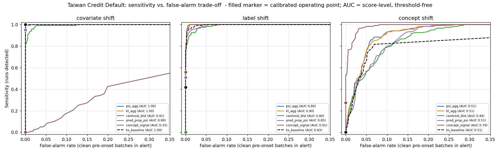
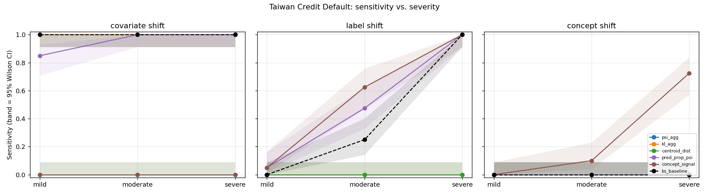
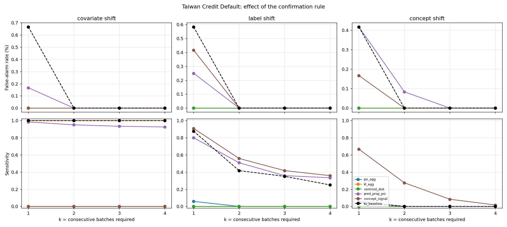
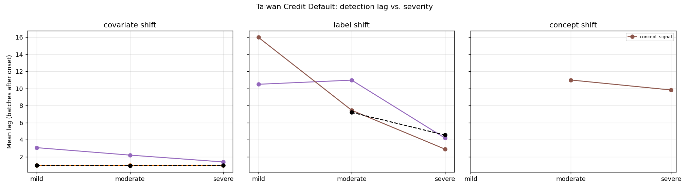
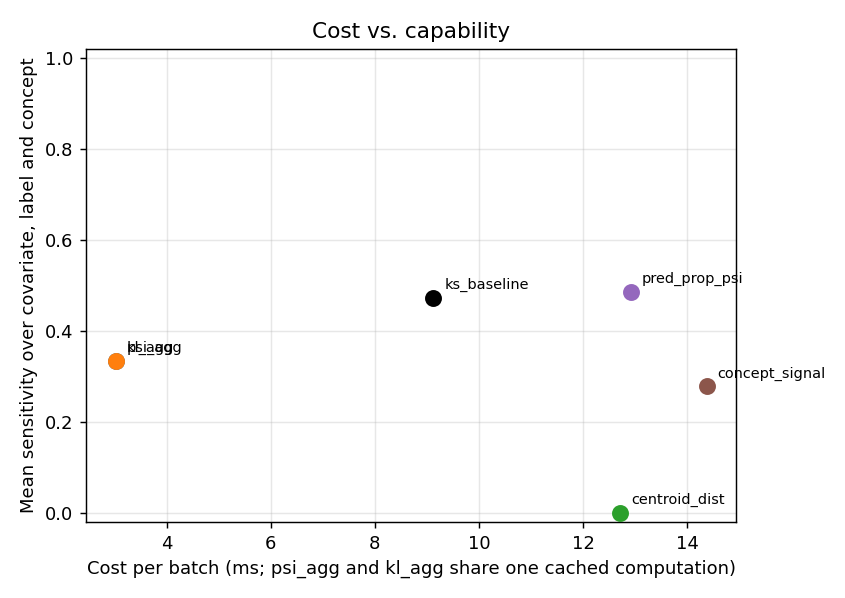

# Taiwan Credit Default - dataset notes

UCI "Default of Credit Card Clients" (Taiwan, 2005): 30,000 rows, no missing values, ~22 % default rate, 20 numeric features
(`LIMIT_BAL`, `AGE`, six `PAY_*` repayment statuses, six `BILL_AMT*`, six `PAY_AMT*`). Source: a public GitHub mirror (`UCI_Credit_Card.csv`);
the official page is https://archive.ics.uci.edu/dataset/350 - verify provenance there if it matters. Target feature: `BILL_AMT1` (most recent bill; closest analogue of `DebtRatio`).

Why it matters: same domain as Give Me Some Credit, but much milder outliers and a third of the rows. With 40 batch-sizes in the data, batches are only **750 rows**,
which is where fixed thresholds fail: the predicted-probability PSI and the Brier-based signal have noise floors near or above their old hand-set thresholds here.
The per-dataset calibration table below shows exactly how far each threshold had to move.

Regenerate: `python datasets/taiwan_credit_default/generate_report_assets_taiwan.py` or `python run_all.py`.
Method, definitions and full results: [`../../REPORT.md`](../../REPORT.md).

## Results (generated)

<!-- BEGIN:dataset_results -->
### Taiwan Credit Default

30,000 rows - batch size 750 - reference window 7,500 rows, disjoint from the 22,500-row stream - 18 scenarios x 20 reps = **360 runs**, each with its own fresh split, reference and fitted detectors - thresholds calibrated on 40 separate clean runs. Target feature: `BILL_AMT1`.

#### Calibrated thresholds

Each detector's noise floor is measured on clean runs whose seeds are disjoint from every evaluation seed; `moderate = max(default floor, 1.25 x 99th percentile of clean scores)`, `significant = max(floor, 2 x moderate)`. The KS baseline is never tuned.

| detector | default floor | clean median | clean 99th pct | calibrated 'moderate' | calibrated 'significant' | raised above floor? |
|---|---|---|---|---|---|---|
| psi_agg | 0.1 | 0.0230 | 0.0429 | 0.1000 | 0.2500 | no |
| kl_agg | 0.1 | 0.0114 | 0.0211 | 0.1000 | 0.2500 | no |
| centroid_dist | 1 | 0.1144 | 0.2592 | 1.0000 | 2.0000 | no |
| pred_prop_psi | 0.015 | 0.0120 | 0.0303 | 0.0379 | 0.0759 | yes |
| concept_signal | 0.025 | 0.0003 | 0.0437 | 0.0547 | 0.1093 | yes |

#### Sensitivity by shift type and severity (mean over onsets)

| shift | severity | psi_agg | kl_agg | centroid_dist | pred_prop_psi | concept_signal | ks_baseline |
|---|---|---|---|---|---|---|---|
| covariate | mild | 1.00 | 1.00 | 0.00 | 0.85 | 0.00 | 1.00 |
| covariate | moderate | 1.00 | 1.00 | 0.00 | 1.00 | 0.00 | 1.00 |
| covariate | severe | 1.00 | 1.00 | 0.00 | 1.00 | 0.00 | 1.00 |
| label | mild | 0.00 | 0.00 | 0.00 | 0.05 | 0.05 | 0.00 |
| label | moderate | 0.00 | 0.00 | 0.00 | 0.47 | 0.62 | 0.25 |
| label | severe | 0.00 | 0.00 | 0.00 | 1.00 | 1.00 | 1.00 |
| concept | mild | 0.00 | 0.00 | 0.00 | 0.00 | 0.00 | 0.00 |
| concept | moderate | 0.00 | 0.00 | 0.00 | 0.00 | 0.10 | 0.00 |
| concept | severe | 0.00 | 0.00 | 0.00 | 0.00 | 0.72 | 0.00 |

#### False alarms: batch-level / share of runs with at least one

Batch-level = fraction of the 10 pre-onset (clean) batches in a confirmed alert state. Runs-with-a-false-alarm = fraction of runs in which any pre-onset batch alerted.

| shift | psi_agg | kl_agg | centroid_dist | pred_prop_psi | concept_signal | ks_baseline |
|---|---|---|---|---|---|---|
| covariate | 0.00% / 0.00% | 0.00% / 0.00% | 0.00% / 0.00% | 0.00% / 0.00% | 0.00% / 0.00% | 0.00% / 0.00% |
| label | 0.00% / 0.00% | 0.00% / 0.00% | 0.00% / 0.00% | 0.00% / 0.00% | 0.00% / 0.00% | 0.00% / 0.00% |
| concept | 0.00% / 0.00% | 0.00% / 0.00% | 0.00% / 0.00% | 0.08% / 0.83% | 0.00% / 0.00% | 0.00% / 0.00% |

#### Trade-off curves

Score AUC = threshold-free separation of pre-onset batches from fully-ramped post-onset batches. Sensitivity @ x% FAR = best sensitivity reachable with at most x% false alarms.

| shift | metric | score AUC | sens. @ 1% FAR | sens. @ 5% FAR |
|---|---|---|---|---|
| covariate | psi_agg | 1.00 | 1.00 | 1.00 |
| covariate | kl_agg | 1.00 | 1.00 | 1.00 |
| covariate | centroid_dist | 0.91 | 0.93 | 0.99 |
| covariate | pred_prop_psi | 0.99 | 0.99 | 1.00 |
| covariate | concept_signal | 0.33 | 0.00 | 0.07 |
| covariate | ks_baseline | 1.00 | 1.00 | 1.00 |
| label | psi_agg | 0.89 | 1.00 | 1.00 |
| label | kl_agg | 0.90 | 1.00 | 1.00 |
| label | centroid_dist | 0.80 | 0.90 | 0.97 |
| label | pred_prop_psi | 0.85 | 0.93 | 0.98 |
| label | concept_signal | 0.91 | 0.99 | 1.00 |
| label | ks_baseline | 0.83 | 0.96 | 1.00 |
| concept | psi_agg | 0.51 | 0.23 | 0.76 |
| concept | kl_agg | 0.51 | 0.24 | 0.71 |
| concept | centroid_dist | 0.49 | 0.17 | 0.57 |
| concept | pred_prop_psi | 0.51 | 0.17 | 0.56 |
| concept | concept_signal | 0.76 | 0.77 | 0.97 |
| concept | ks_baseline | 0.51 | 0.17 | 0.64 |

#### The confirmation rule (k consecutive batches), lag and cost

An alert needs k consecutive batches above threshold. k = 2 is used everywhere else; this shows what k buys, for the best detector of each shift type, with the calibrated thresholds. Lag = batches after onset, detected runs only.

| shift | detector | k | sensitivity | false alarms | mean lag (batches) |
|---|---|---|---|---|---|
| covariate | psi_agg | 1 | 1.00 | 0.00% | 0.0 |
| covariate | psi_agg | 2 | 1.00 | 0.00% | 1.0 |
| covariate | psi_agg | 3 | 1.00 | 0.00% | 2.0 |
| covariate | psi_agg | 4 | 1.00 | 0.00% | 3.0 |
| label | concept_signal | 1 | 0.91 | 0.42% | 4.4 |
| label | concept_signal | 2 | 0.56 | 0.00% | 4.9 |
| label | concept_signal | 3 | 0.42 | 0.00% | 5.2 |
| label | concept_signal | 4 | 0.36 | 0.00% | 5.9 |
| concept | concept_signal | 1 | 0.67 | 0.17% | 6.2 |
| concept | concept_signal | 2 | 0.28 | 0.00% | 10.0 |
| concept | concept_signal | 3 | 0.08 | 0.00% | 12.8 |
| concept | concept_signal | 4 | 0.02 | 0.00% | 16.5 |

#### Against the named baseline

Baseline = per-feature two-sample Kolmogorov-Smirnov test, Bonferroni-corrected, alpha 0.01, same 2-consecutive-batch rule, same runs, no tuning.

| shift | best of the five | its sens. | its false alarms | KS baseline sens. | KS false alarms | gain vs. baseline |
|---|---|---|---|---|---|---|
| concept | concept_signal | 0.28 | 0.00% | 0.00 | 0.00% | 0.28 |
| covariate | psi_agg | 1.00 | 0.00% | 1.00 | 0.00% | 0.00 |
| label | concept_signal | 0.56 | 0.00% | 0.42 | 0.00% | 0.14 |

#### What diagnosis.py says when something alerts

Share of post-onset alerting batches by verdict, per true injected shift.

| true_shift_type | concept_or_mild_label | covariate | label | label_or_subtle_covariate |
|---|---|---|---|---|
| concept | 100.0% | 0.0% | 0.0% | 0.0% |
| covariate | 0.0% | 100.0% | 0.0% | 0.0% |
| label | 39.1% | 0.0% | 47.0% | 13.9% |

#### Reference model

| reference base rate | reference mean pred. | held-out base rate | held-out mean pred. | held-out accuracy | held-out ROC-AUC |
|---|---|---|---|---|---|
| 0.2176 | 0.2176 | 0.2224 | 0.2195 | 0.8113 | 0.7200 |

#### Cost

| detector | per_batch_ms | one_time_fit_ms | throughput_batches_per_sec | approx_memory_kb |
|---|---|---|---|---|
| psi_agg + kl_agg (shared cached bins) | 3.02 | 14.73 | 330.80 | 4.40 |
| centroid_dist | 12.72 | 34.96 | 78.60 | 180.70 |
| pred_prop_psi | 12.91 | 68.55 | 77.40 | 67.10 |
| concept_signal | 14.38 | 17.63 | 69.50 | 4.90 |
| ALL 5 COMBINED (full pipeline per batch) | 43.04 | 121.14 | 23.20 | 257.10 |
| ks_baseline (named baseline, not part of the 5) | 9.13 | 7.14 | 109.60 | 2345.70 |

#### Failure modes

80 (shift, severity, onset, detector) cells have sensitivity below 0.5 or mean lag above 5 batches - see `datasets/taiwan_credit_default/report_assets_taiwan/failure_modes.csv`.

#### Provenance

`datasets/taiwan_credit_default/report_assets_taiwan/system_info.json`: platform=Windows-10-10.0.26200-SP0, python_version=3.11.0, numpy_version=2.4.4, pandas_version=3.0.2, sklearn_version=1.8.0, scipy_version=1.17.1, matplotlib_version=3.10.0, generated 2026-11-17T04:34:23Z. Run time 590s.
<!-- END:dataset_results -->
